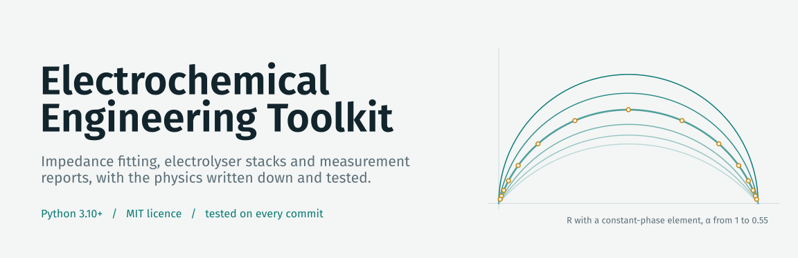
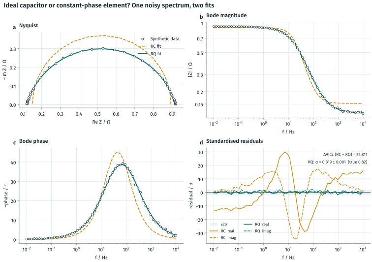
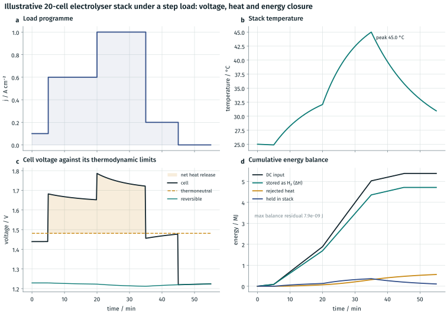
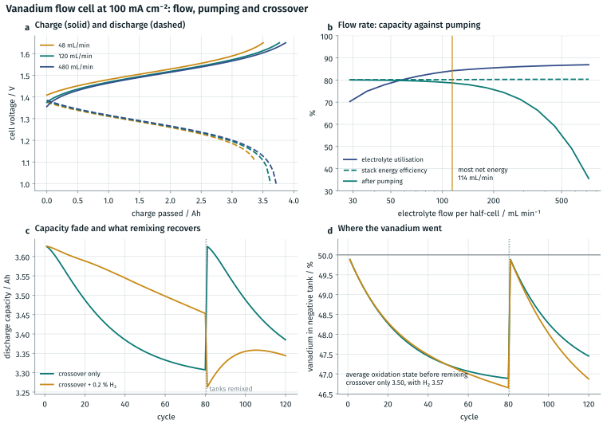
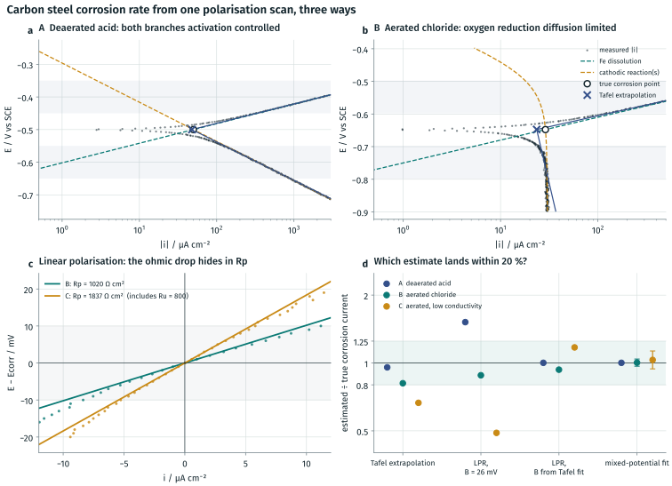
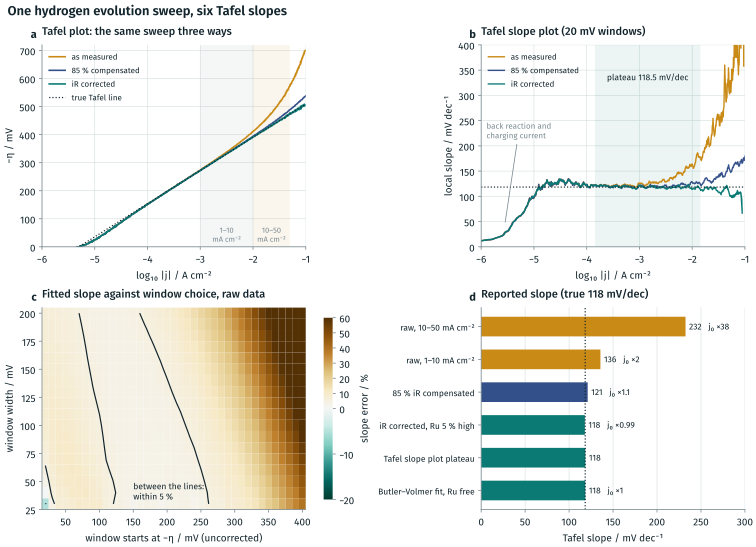

<picture>
  <source media="(prefers-color-scheme: dark)" srcset="https://raw.githubusercontent.com/pooriamn/electrochem-toolkit/main/docs/assets/hero-dark.svg">
  
</picture>

[](https://github.com/pooriamn/electrochem-toolkit/actions/workflows/verify.yml)


[](LICENSE)

Most electrochemistry labs run on a handful of calculations that get rewritten in every new spreadsheet: fit an impedance spectrum, balance a stack, integrate a test file. This repository is where I keep my versions of them, written as a small Python package, with the equations and assumptions stated and a test for each result that matters.

There are two layers. The **core toolkit** has no dependencies beyond the standard library and covers the everyday work. The **computational studies** use NumPy and SciPy for the harder questions, the ones where a wrong answer looks perfectly reasonable: whether an impedance model is actually supported by the data, where the heat goes in an electrolyser stack, how hard to pump a flow battery, how far to trust a corrosion rate, and what a Tafel slope really measures.

**[Try it in the browser](https://pooriamn.github.io/electrochem-toolkit/)**, no install needed.

## Studies

Five so far. Each runs on synthetic data with a known answer, so the method is judged on whether it gets that answer back. [All studies →](studies/README.md)

### Ideal capacitor or constant-phase element?

A small residual doesn't tell you the circuit is right. This study fits the same noisy synthetic spectrum with an RC and an RQ (constant-phase) circuit using weighted complex least squares, an analytic Jacobian and multistart, then compares them with AICc and checks identifiability from the Jacobian's singular values.



The RC fit leaves residuals of up to 30σ with obvious structure; the RQ residuals sit inside ±2σ. The RQ fit recovers α = 0.819 ± 0.001 against a true value of 0.82, and AICc prefers it by about 22,800. [Method, assumptions and limits →](studies/eis-inverse/README.md)

### Where does the heat go in an electrolyser stack?

A lumped electrothermal model couples Nernst-corrected reversible voltage, apparent Butler–Volmer kinetics and an Arrhenius area-specific resistance to a heat balance, then runs it through a step load. Electrical, chemical, heater and rejected-heat energies are integrated as extra ODE states, so the energy balance can be checked directly rather than assumed.



Above the thermoneutral voltage (shaded) the stack heats; below it, it cools. Over the 55-minute run the balance closes to within 10⁻⁸ J. [Equations and numerical checks →](studies/electrothermal-stack/README.md)

### How hard should a flow battery pump?

A lumped vanadium flow cell with four-species membrane crossover, single-pass mass transfer and Darcy pumping losses, cycled between voltage limits for 120 cycles.



Net energy per cycle peaks near 115 mL/min, even though stack efficiency barely changes with flow. Crossover costs 0.11 % capacity per cycle and remixing gets all of it back. With 0.2 % hydrogen evolution added, remixing makes capacity *worse*, because the oxidation-state drift needs fixing as well. [Model and results →](studies/flow-battery/README.md)

### When can you trust a corrosion rate?

Tafel extrapolation, linear polarisation resistance and a full mixed-potential fit, run on synthetic carbon-steel scans where the true corrosion current is known: deaerated acid, aerated chloride, and aerated chloride with an 800 Ω cm² ohmic drop.



LPR with the default B = 26 mV ranges from 49 % to 152 % of the true rate across the three cases. The mixed-potential fit stays within 3 % in all of them and recovers the ohmic resistance as well. [Methods and limits →](studies/corrosion/README.md)

### What does a Tafel slope actually measure?

One hydrogen evolution sweep with ohmic drop, charging current and noise, analysed six ways, from a straight line through raw data to a Butler–Volmer fit of the whole curve.



The true slope is 118 mV/dec. A straight line through the uncorrected 10–50 mA cm⁻² region gives 232 mV/dec with R² = 0.989. The Tafel slope plot and the full fit both land within 0.5 %. [What to report instead →](studies/tafel-analysis/README.md)

## Quick start

```sh
python -m pip install "git+https://github.com/pooriamn/electrochem-toolkit"
electrochem-toolkit stack --cells 10 --area 100 --density 0.3 --voltage 1.8
```

```json
{
  "current_A": 30.0,
  "stack_voltage_V": 18.0,
  "dc_power_kW": 0.54,
  "hydrogen_kg_h": 0.011282286914306576,
  "dc_specific_energy_kWh_kg": 47.862636724408205
}
```

The same functions are importable:

```python
from electrochem_toolkit.stack import calculate
result = calculate(cells=10, area_cm2=100, current_density=0.3, cell_voltage=1.8, efficiency=0.95)
print(f"{result['dc_specific_energy_kWh_kg']:.1f} kWh/kg H2")   # 50.4
```

For the studies, install the optional extras and run them from a clone:

```sh
python -m pip install ".[advanced]"
python studies/eis-inverse/run.py
python studies/electrothermal-stack/run.py
python studies/flow-battery/run.py
python studies/corrosion/run.py
python studies/tafel-analysis/run.py
```

## What's in the package

| Module | What it does |
| --- | --- |
| `impedance` | Rs + (Rct ∥ C) response, Bode magnitude and phase, transparent grid fitting |
| `inverse` | Weighted complex least squares for RC/RQ circuits, analytic Jacobian, AICc, local uncertainty |
| `stack` | Series stack DC balance, Faradaic hydrogen rate, specific energy |
| `electrothermal` | Dynamic stack model with thermodynamics, kinetics, ohmic losses and heat balance |
| `flowbattery` | Vanadium flow cell with crossover, mass transfer, pumping and remixing |
| `corrosion` | Mixed-potential polarisation curves, Tafel extrapolation, LPR, full-curve fit, ASTM G102 rates |
| `kinetics` | Butler–Volmer sweeps with ohmic drop, Tafel slope plots, window analysis, full-curve fit |
| `polarisation` | Tafel regression over a region you choose |
| `battery` | Charge and discharge throughput from signed current, split at zero crossings |
| `pipeline` | CSV validation, energy and charge integration, atomic JSON reports with a source hash |

The [`examples/`](examples/README.md) folder has three short, dependency-free scripts that are easy to read in one sitting, and [`notes/`](notes/README.md) explains some of the design decisions.

## Scope

Everything here runs on synthetic data, and the models are as simple as the question allows. That's deliberate: it keeps every result checkable against an independent calculation. None of it is a substitute for validating against your own measurements, and none of it is meant for equipment control or safety decisions. Each study README says exactly where its model stops.

## Contributing and citing

Bug reports with a reproducer are the most useful thing you can send; see [CONTRIBUTING.md](CONTRIBUTING.md). If the toolkit helps your work, the citation details are in [CITATION.cff](CITATION.cff) (GitHub's "Cite this repository" button uses it).

MIT licensed. Written by [Pooria Moozarm Nia](https://github.com/pooriamn), electrochemist in London ([Google Scholar](https://scholar.google.com/citations?user=SaiB5-8AAAAJ), [ORCID](https://orcid.org/0000-0002-3049-3120)).
