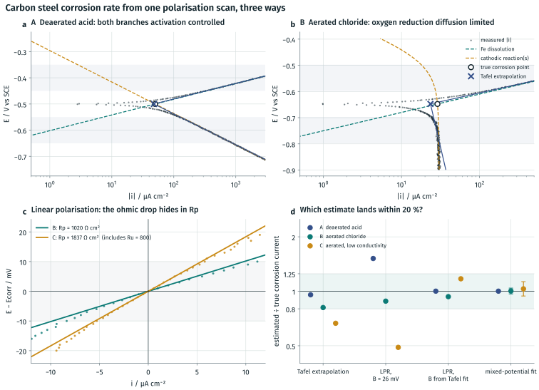

# Corrosion rate from a polarisation scan

A potentiodynamic scan on carbon steel takes about twenty minutes. Turning it into a corrosion rate takes a few seconds in the instrument software, and that step is where most of the error comes in. This study runs three common methods on the same synthetic scans, where the true corrosion current is known, and shows when each one can be trusted.

## Model

The electrode follows mixed-potential theory (Wagner and Traud): the measured current is the sum of independent partial reactions, each a Tafel line:

```text
i_Fe  =  i_ref,Fe · 10^((E − E_ref,Fe)/β_a)                         iron dissolution
i_O2  = −i_k i_L / (i_k + i_L),   i_k = i_ref,O2 · 10^(−(E − E_ref,O2)/β_c)   oxygen reduction
i_H   = −i_ref,H · 10^(−(E − E_ref,H)/β_H)                          hydrogen evolution
i     =  i_Fe + i_O2 + i_H
```

The corrosion potential is where *i* = 0, and the corrosion current is *i_Fe* at that potential. The potentiostat controls the applied potential, but the interface sees E_app − i R_u, so every point needs an implicit solve. A sweep also adds a double-layer charging current C_dl·ν.

Three cases, all carbon steel:

| | Situation | Cathode | R_u / Ω cm² | True i_corr / µA cm⁻² |
| --- | --- | --- | --- | --- |
| A | Deaerated acid | H₂ evolution, β = 120 mV/dec | 0 | 50.0 (0.58 mm/y) |
| B | Aerated chloride, near neutral | O₂ reduction, limited at 30 µA cm⁻² | 0 | 28.9 (0.34 mm/y) |
| C | Same as B, low-conductivity water | as B | 800 | 28.9 (0.34 mm/y) |

Each scan runs from E_corr − 250 mV to E_corr + 250 mV at 0.6 V/h with 1 mV steps. Noise is 2 % of the current plus 5 nA cm⁻².

## The three methods

**Tafel extrapolation.** Fit straight lines to log|i| between 50 and 150 mV either side of the zero-current potential, and take their intersection.

**Linear polarisation resistance (LPR).** Fit E against i within ±10 mV of E_corr to get R_p, then use Stern and Geary [1]:

```text
i_corr = B / R_p,     B = β_a β_c / (2.303 (β_a + β_c))
```

Two variants are run: the common default B = 26 mV (β_a = β_c = 120 mV/dec), and B calculated from the Tafel slopes found in the first method. When the cathode is fully diffusion limited, β_c → ∞ and B = β_a / 2.303.

**Mixed-potential fit.** Fit the whole curve by weighted least squares, with R_u as a free parameter and the ohmic drop solved implicitly at each point. Two models are fitted, one with an activation-controlled cathode and one with a diffusion limit, and AICc chooses between them. The limiting current is fitted as log₁₀(i_L / i_corr), which keeps every trial point physical. Six starting values of R_u guard against the local minima you get when R_u and β_a trade off against each other.

## Results



| Estimate ÷ true i_corr | A | B | C |
| --- | --- | --- | --- |
| Tafel extrapolation | 0.96 | 0.81 | 0.67 |
| LPR, B = 26 mV | 1.52 | 0.88 | 0.49 |
| LPR, B from Tafel fit | 1.00 | 0.93 | 1.17 |
| Mixed-potential fit | 1.00 | 1.00 | 1.03 |

**A is the textbook case,** and even here Tafel extrapolation reads about 5 % low. At 50 mV cathodic of E_corr, the anodic reaction still carries a few per cent of the current, so the cathodic line is slightly off. A noise-free test confirms that this comes from the 50–150 mV window, not from noise; moving the window out to 150–300 mV removes it. LPR with the default 26 mV overestimates by half, because β_a here is 60 mV/dec, not 120. Using measured Tafel slopes fixes it.

**B is what most real steel in aerated water looks like.** The cathodic branch is a plateau, so a straight line drawn through it means nothing. The fitted "Tafel slope" of 1.28 V/dec is the tell. Extrapolation reads 19 % low. The full fit picks the diffusion-limited model by an AICc margin of about 47,000 and recovers i_corr to within 0.4 %. It also shows that i_corr is barely below the oxygen limiting current, which is the physical point: the steel corrodes as fast as oxygen can reach it.

**C adds an 800 Ω cm² ohmic drop,** which is easy to reach in condensate or dilute cooling water. Rp now includes R_u, so LPR with the default B reads half the true rate. Tafel extrapolation gets worse, and the apparent anodic slope nearly triples, to 180 mV/dec. LPR with B from the Tafel fit lands at 1.17, but only because two errors partly cancel; I wouldn't rely on that. The mixed-potential fit recovers R_u as 794 Ω cm² and i_corr within 3 %. β_c is pinned at its bound, which is the honest answer: once the cathode is fully limited, the data contain no information about its kinetic slope.

If an independent R_u is available (for example the high-frequency intercept from EIS), subtracting it from R_p before applying Stern–Geary is the simplest fix for C.

## Reproduce

```sh
python -m pip install ".[advanced]"
python studies/corrosion/run.py
```

The script writes `summary.json` (true values, every estimate, fitted parameters, standard errors and AICc) and the figure to `study-output/corrosion/`.

## Where this model stops

Real steel is not a set of fixed Tafel lines. Scanning changes the surface: corrosion products form, pits initiate, and the anodic branch above E_corr is often the least reliable part of the curve. Solution-side effects such as pH drift at the surface, bubble coverage and changing oxygen supply are not modelled. Uniform corrosion is assumed throughout, so none of these rates says anything about localised attack. For real measurements, compare the electrochemical rate with mass loss (ASTM G1/G31) at least once for each system before trusting it on its own.

The ASTM G102 conversion uses EW = 27.92 (Fe → Fe²⁺) and ρ = 7.87 g cm⁻³: 1 µA cm⁻² ≈ 0.0116 mm/y.

## References

1. M. Stern and A. L. Geary, "Electrochemical polarization I. A theoretical analysis of the shape of polarization curves", *J. Electrochem. Soc.* 104 (1957) 56.
2. ASTM G102, *Standard Practice for Calculation of Corrosion Rates and Related Information from Electrochemical Measurements*.

[Implementation](../../src/electrochem_toolkit/corrosion.py) · [Verification tests](../../tests/test_corrosion.py)
