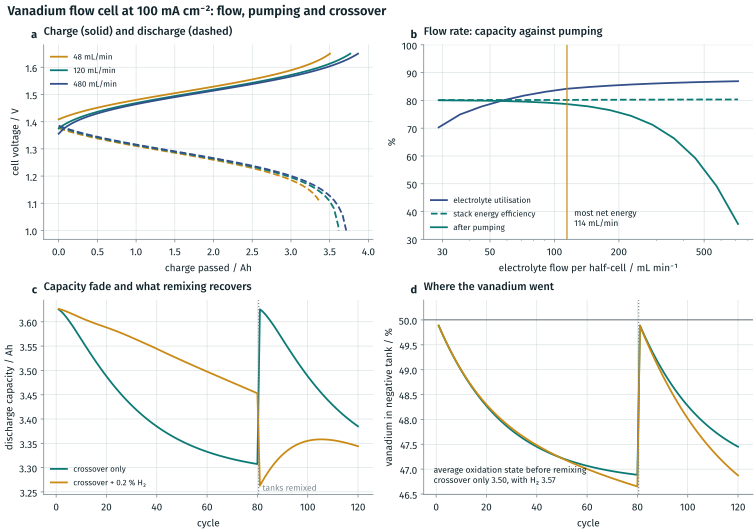

# Flow battery: flow rate, pumping and capacity fade

Two questions come up whenever a flow cell goes on test, whatever the chemistry. How much electrolyte should we pump? And why has the capacity dropped by cycle 50, and is it coming back? This study answers both with a lumped single-cell model, kept simple enough that every term can be checked by hand.

The cell, flow and pumping parts apply to any flow battery with two soluble redox couples. Crossover depends on the chemistry, so it is described separately. The worked example is the all-vanadium system, the best characterised of them, but any other chemistry can be swapped in without touching the rest of the model.

## Model

The cell has 100 cm² of porous carbon electrode on each side, and a 100 mL tank per side holding 1.6 M of active species. The model tracks four species in moles: the charged and discharged forms of the negative couple, and the discharged and charged forms of the positive couple. Each tank and its half-cell are treated as one well-mixed volume.

**Cell voltage** at current density *i* (positive on charge, *s* = ±1):

```text
E_ocv = E0' + (RT/F) ln( c_neg,ch c_pos,ch / (c_neg,dis c_pos,dis) )
η_act = (2RT/F) [ asinh(i / 2i0,−) + asinh(i / 2i0,+) ],   i0 = F k aL √(c_ox c_red)
η_mt  = −(RT/F) Σ ln(1 − i / i_lim),   i_lim = F k_m aL c̄,   k_m = b u^0.4
V     = E_ocv + s (η_act + η_mt + i ASR)
```

E0' is a formal cell potential that absorbs the activity terms, so it holds only for a fixed supporting electrolyte. *aL* is the electrode surface area per unit geometric area. For the mass-transfer term, c̄ is the mean of the inlet and outlet reactant concentrations, with the outlet set by single-pass conversion, c_out = c_in − I/(FQ). If c_out reaches zero the electrolyte can't carry enough reactant through the cell, and the half-cycle ends. At low flow rates that is what actually limits capacity, more than the kinetics. None of this depends on the chemistry beyond E0' and the two rate constants.

**Pumping.** Pressure drop is Darcy flow through the porous electrode, ΔP = μuL/K. Pump power for both half-cells is 2ΔPQ/η_pump. Pipes, manifolds and shunt currents are left out.

**Crossover** is where chemistries differ. Each species diffuses through a 125 µm membrane at the rate D_i A c_i / δ. What happens next is set by a 4 × 4 table in the `Chemistry` object, and falls into one of two cases:

- **Both electrolytes share one active element** (all-vanadium, and some symmetric organic and metal-complex systems). A crossing ion reacts with the other electrolyte and nothing leaves the system. The loss is an imbalance between the tanks, and remixing can recover it.
- **Two different elements** (iron–chromium or zinc–bromine, for example, or most asymmetric organics). A crossing ion contaminates the other side and is lost from the active inventory. `lost_crossover()` gives that table. Remixing doesn't apply, and the model refuses to do it.

**Side reactions.** Hydrogen evolution can optionally take a fixed share of the negative-electrode charging current. It's the one process here that changes the average oxidation state, and that change is permanent.

## Worked example: all-vanadium

For vanadium the four species are V(II), V(III), V(IV) and V(V), with E0' = 1.40 V. A crossing ion reacts immediately on arrival, following the mass-balance scheme of Tang, Bao and Skyllas-Kazacos [1]:

```text
positive side:  V²⁺ + 2VO₂⁺ → 3VO²⁺        V³⁺ + VO₂⁺ → 2VO²⁺
negative side:  VO²⁺ + V²⁺ → 2V³⁺           VO₂⁺ + 2V²⁺ → 3V³⁺
```

This conserves both vanadium and electrons. I chose diffusion coefficients that put V(II) and V(IV) through the membrane faster than V(III) and V(V). That gives a net drift of vanadium to the positive side, which is the direction usually reported for cation-exchange membranes. The values are illustrative, not fitted to a particular membrane.

## Numerical approach

- Each half-cycle runs at constant current, integrated with `solve_ivp` (rtol 1e-8). It stops on a voltage event at 1.65 V (charge) or 1.00 V (discharge), or when the single-pass supply runs out.
- Efficiencies come from the third cycle, once the start-up transient has gone. Coulombic efficiency is discharge over charge Ah, energy efficiency is discharge over charge Wh, and voltage efficiency is their ratio. System efficiency charges the pump energy to each half-cycle.
- Remixing combines both tanks, splits the inventory equally and returns it to a discharged state. Any net shift in oxidation state stays behind as charged positive species.

## Results for the all-vanadium example



At 100 mA cm⁻² and 120 mL/min per half-cell, the settled cycle gives 96.0 % coulombic, 83.5 % voltage and 80.2 % energy efficiency. Once pumping is counted, energy efficiency is 78.5 %.

**Flow rate (b).** At the lowest flow, around 30 mL/min, the charge stops before the voltage limit because a single pass can no longer deliver the reactant the current needs. Between there and about 100 mL/min, mass-transfer overpotential at high SOC pushes the cell to its voltage limit early, so utilisation climbs steadily with flow. Above about 250 mL/min the pump losses grow quickly, since they scale with u². Taking net energy per cycle (discharge energy minus all pump energy) as the measure, the best flow is close to 115 mL/min for this geometry. Stack energy efficiency, the dashed line, hardly moves across the whole range. That's the trap: judged on stack efficiency alone, there's no reason not to pump harder. This trade-off is general. Only where the optimum sits depends on the chemistry, through concentration, kinetics and viscosity.

**Capacity fade (c, d).** With crossover alone, capacity falls by 0.11 % per cycle over the first 80 cycles, and the negative tank ends up holding 46.9 % of the active species. Remixing restores the first-cycle capacity exactly, because nothing was lost; it was only in the wrong tank.

Add 0.2 % hydrogen evolution and the story changes. The fade before remixing is actually slower, at 0.06 % per cycle, because the oxidation-state drift (average 3.57 by cycle 80) partly offsets the imbalance between tanks. Remixing then removes the imbalance but not the drift, and capacity drops further, from 3.45 to 3.26 Ah. A cell like this needs an oxidation-state correction, chemical or electrochemical, as well as a remix. That's worth knowing before deciding remixing "didn't work".

For a two-element chemistry the same panels read differently: crossover becomes permanent contamination, so the fade in (c) doesn't recover on remixing at all, and keeping crossover low through the choice of membrane matters more than any maintenance schedule.

## Running it for another chemistry

Describe the chemistry and pass it to the cell. Everything else stays the same:

```python
from dataclasses import replace
from electrochem_toolkit import flowbattery as fb

my_chem = fb.Chemistry(
    name="my couple pair",
    formal_potential_V=1.10,          # at 50 % SOC in your supporting electrolyte
    k_neg_m_s=5e-8, k_pos_m_s=5e-8,   # standard rate constants
    diffusivity_m2_s=(5e-12,) * 4,    # membrane diffusivity of each species
    crossover=fb.lost_crossover(),    # two different elements: crossing ions are lost
)
cell = fb.FlowCell(chemistry=my_chem)
charge, discharge, metrics = fb.cycle(cell, fb.Electrolyte(), fb.Electrolyte().initial_state(),
                                      10.0, 5e-3, v_max=1.40, v_min=0.75)
```

Set the voltage limits for the new chemistry, and check that its couples are single-electron and fully soluble. Those are both assumptions of the model.

## Reproduce

```sh
python -m pip install ".[advanced]"
python studies/flow-battery/run.py
```

The script writes `summary.json`, `flow_sweep.csv` and the figure to `study-output/flow-battery/`. The two 120-cycle runs take a few seconds.

## Where this model stops

The tanks and half-cells are treated as one well-mixed volume, so there are no concentration gradients along the electrode and no spatial current distribution. Couples are assumed to transfer one electron and to stay in solution, which excludes hybrid systems with plating (zinc–bromine, all-iron) unless the plated side is modelled separately. Electro-osmotic and osmotic water transfer are excluded, and in real cells they are often as important as diffusion for long-term imbalance. Also excluded: migration under the cell field, temperature effects on diffusion, air oxidation, precipitation and the electrolyte degradation that limits many organic chemistries. The mass-transfer coefficient *b* is set so transport matters at high SOC and low flow; it is not a correlation for any particular electrode. Use the model to reason about trends and to design an experiment, not to predict the cycle life of a real stack.

## References

1. A. Tang, J. Bao and M. Skyllas-Kazacos, "Dynamic modelling of the effects of ion diffusion and side reactions on the capacity loss for vanadium redox flow battery", *J. Power Sources* 196 (2011) 10737–10747. [doi:10.1016/j.jpowsour.2011.09.003](https://doi.org/10.1016/j.jpowsour.2011.09.003)

[Implementation](../../src/electrochem_toolkit/flowbattery.py) · [Verification tests](../../tests/test_flowbattery.py)
