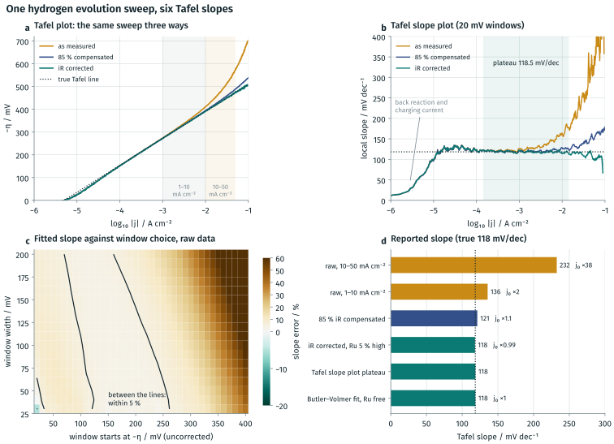

# Tafel analysis: one sweep, six slopes

Tafel slopes get reported to the nearest mV/dec and then used to argue for a mechanism. A quoted 120 mV/dec points to a rate-limiting first electron transfer; 40 or 30 mV/dec point to something else. But the slope you get from a sweep depends heavily on choices that rarely make it into the methods section: how much of the ohmic drop was removed, and which part of the curve the straight line went through. This study takes one synthetic hydrogen evolution sweep with a known answer and measures how far each common choice moves the result.

## Model

The interface follows Butler–Volmer kinetics for a single-step reaction:

```text
j = j0 [ exp(α_a f η) − exp(−α_c f η) ],    f = F/RT,    α_a = 1 − α_c
```

With α_c = 0.5 at 25 °C, the true Tafel slope is 2.303 RT / (α_c F) = **118.3 mV/dec**, and j0 = 5 µA cm⁻² (roughly nickel in alkaline solution). The sweep is what a potentiostat would record:

- Applied potential runs from +0.05 to −0.70 V vs RHE at 5 mV/s with 1 mV steps.
- The interface sees E_app − j R_u, with R_u = 2 Ω cm², solved implicitly at every point.
- A rough electrode has C_dl = 1 mF cm⁻², so the sweep carries a steady charging current of −5 µA cm⁻². That's the same size as j0.
- Noise is 1 % of the current plus 0.2 µA cm⁻².

Bubbles, mass transport of the product, catalyst changes during the sweep and the multi-step nature of real HER are all left out. The point is to isolate the effects that come from analysis, not chemistry.

## Six ways to report a slope

1. **Raw data, 10–50 mA cm⁻².** The visually straight high-current part of an uncorrected curve, still common in screening papers.
2. **Raw data, 1–10 mA cm⁻².** The same, one decade lower.
3. **85 % positive-feedback compensation**, fitted over 1–10 mA cm⁻². This is the instrument default in a lot of labs, and it leaves 0.3 Ω cm² in the data.
4. **Post-hoc iR correction** using an R_u estimate 5 % too high, as you might get from the high-frequency intercept of an impedance spectrum.
5. **Tafel slope plot.** The local slope over sliding 20 mV windows, plotted against log|j|. The reported value is the median of the longest stretch that stays within ±5 % of itself, following van der Heijden et al. [1].
6. **Butler–Volmer fit to the whole sweep**, with j0, α_c, R_u and a constant charging current all free, using weighted least squares with the same implicit ohmic solve as the simulation.

## Results



| Method | Slope / mV dec⁻¹ | j0 ÷ true | R² of line |
| --- | --- | --- | --- |
| Raw, 10–50 mA cm⁻² | 232 | 38 | 0.989 |
| Raw, 1–10 mA cm⁻² | 136 | 2.0 | 0.9985 |
| 85 % compensated | 121 | 1.14 | 0.9998 |
| iR corrected, R_u 5 % high | 118 | 0.99 | 0.9997 |
| Tafel slope plot plateau | 118.5 | – | – |
| Butler–Volmer fit | 118.4 ± 0.04 | 1.00 | – |

**R² tells you nothing here.** Every straight line in the table has R² above 0.98, including the one that doubles the slope and puts j0 out by a factor of 38. A sweep with 2 Ω cm² left in it is still a smooth, nearly straight curve over a decade. You can't see the problem on a Tafel plot (panel a); you can see it immediately on a slope plot (panel b), where the uncorrected curve never settles.

**The low-current end is no safer.** Below about 10 µA cm⁻² the local slope falls away. Two things cause it: the anodic back reaction, which is still about a tenth of the cathodic rate at 60 mV, and the −5 µA cm⁻² charging current, which is as large as the faradaic current there. On the corrected data, windows that start below about 120 mV are biased 5–10 % high for this reason. That's why the plateau in panel b runs from roughly 0.14 to 14 mA cm⁻², and not lower.

**Window choice (c).** Of the 702 windows mapped on the raw data, only 219 give a slope within 5 % of the truth. They sit in a diagonal band that you would only find if you already knew the answer.

**What works.** A full correction with a reasonable R_u, the slope-plot plateau and the Butler–Volmer fit all land within 0.5 % of 118.3 mV/dec. A 5 % error in R_u moves the slope by less than 1 mV/dec in the 1–10 mA window, so an impedance-derived R_u is good enough. The full fit has two advantages: it uses every point, including the region near equilibrium, and it returns R_u (1.993 ± 0.003 against 2.000 Ω cm²) and the charging current (−5.02 against −5.00 µA cm⁻²) as checks.

What I'd report from a real sweep: the iR-corrected Tafel slope plot, the current range of the plateau, how R_u was measured, and the scan rate. If there is no plateau, that is itself the result, and a single number shouldn't be quoted.

## Reproduce

```sh
python -m pip install ".[advanced]"
python studies/tafel-analysis/run.py
```

The script writes `summary.json` (truth, every estimate, the full fit with standard errors and the window-map statistics) and the figure to `study-output/tafel-analysis/`.

## Where this model stops

Real HER on nickel isn't a single-step reaction with constant α. Coverage effects change the slope with potential, which is exactly what a slope plot is meant to reveal, and a constant-α Butler–Volmer fit would hide it. Hydrogen bubbles block the surface and add noise at high current. The catalyst may reduce, roughen or change during the sweep, so a slow scan on a fresh electrode and a fast scan after conditioning can disagree for real reasons. The charging current here is constant; on a real electrode it depends on potential and on any pseudo-capacitance. Steady-state chronoamperometry steps avoid the charging problem entirely and are worth the extra time when the slope matters.

## References

1. O. van der Heijden, S. Park, R. E. Vos, J. J. J. Eggebeen and M. T. M. Koper, "Tafel slope plot as a tool to analyze electrocatalytic reactions", *ACS Energy Lett.* 9 (2024) 1871–1879. [doi:10.1021/acsenergylett.4c00266](https://doi.org/10.1021/acsenergylett.4c00266)

[Implementation](../../src/electrochem_toolkit/kinetics.py) · [Verification tests](../../tests/test_kinetics.py)
